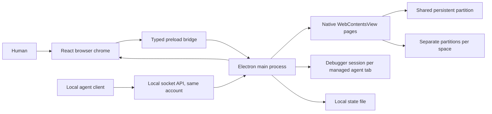

# Architecture

Kamapathy separates browser chrome, remote web pages, and native capabilities. Its UI is React and TypeScript. Electron provides Chromium rendering, operating system windows, session storage, and downloads.

## Process boundary

The shell renderer owns layout, keyboard interactions, panels, and the command palette. It receives browser state and dispatches typed actions through `KamapathyBridge`. The preload exposes that interface instead of arbitrary IPC or Node.js primitives.

The main process owns the authoritative native state and tab lifecycle. Each remote tab is a separate `WebContentsView`. Remote pages use sandboxing, context isolation, and disabled Node integration. They do not receive the browser shell preload. See [Electron's WebContentsView documentation](https://www.electronjs.org/docs/latest/api/web-contents-view) for the rendering primitive.

Popups are adopted rather than reloaded. When a page calls `window.open` or follows a link or form that targets a new window, the window open handler allows it with `outlivesOpener`, so the popup survives its opener, and a `createWindow` callback that wraps the child contents Chromium made in a `WebContentsView` and registers it as a tab in the opener's space. The popup keeps its opener, its name and any form body, and it shares the opener's session. Popup web preferences match tab views: both come from the same builder, so popups get the same sandboxing, isolation and throttling as tabs. Chromium makes no child contents for a click with a modifier key, so the controller creates that tab's view itself and loads the URL with its referrer and any URL-encoded or multipart form body. A popup's contents being destroyed, as after `window.close()`, closes its tab.

The renderer reports the rectangle reserved for web content. The main process positions the active native view in that rectangle, or positions two views for split view. Native views draw above the shell, so before a popover, grid or dialog covers the page the renderer asks the main process for still captures of the visible views, draws them in their place, and only then asks it to hide the views. Closing shows the views again before the captures are removed, so the page area is never blank. If a capture fails or takes longer than 300 ms, the page area is shown empty instead.

The agent cursor is one more native view per window, kept above the page views. It is a transparent `WebContentsView` with sandboxing, context isolation and no preload that loads a fixed local page, a second renderer entry built beside the shell. The main process places it from the page view's origin plus the point an agent acted on times that view's zoom factor, clipped inside the page, and sends it nothing but the cleaned label and whether a press is playing. It refuses navigation and window opening, hides when the person's own pointer reaches it, and hands focus back to the page view below, so it never takes a click meant for the page. `electron/agent/cursor.ts` holds the view and its motion, and `electron/agent/presence.ts` reports each point to it.

The window's lifecycle follows the agents. While agent access is on and the agent service runs, closing the window hides it instead of quitting: on macOS always, and on Windows and Linux while an agent space or a granted personal space is open. Hiding closes the person's own pages, keeps the agent views, the controller and the socket, and adds a tray icon on Windows and Linux. The tray and the macOS Dock menu list the agent spaces with their states and open the window on one; the Dock icon, a second launch and a notification show it again, after which the person's views are made as they open them. A quit while a space is the agent's own or needs the person asks first and, once confirmed, writes the private `quit` marker in the agent folder that keeps the client from starting Kamapathy for ten minutes. `electron/background.ts` owns these rules, and the tray, the menus and the window all read one status function, `agentStatus` in `src/lib/spaces.ts`, so the tray can never say something the window does not.

## Agent engine

The agent server lives in `electron/agent/`. `server.ts` listens on the private socket and checks each request's origin and authority. Routes in `routes/` declare a lane and a time budget, and `scheduler.ts` runs one request at a time per space and up to six spaces at once, letting a wait step aside between checks. Each tab an agent manages gets one `TabSession` (`session/tab-session.ts`), the only code that uses Electron's debugger: it follows the tab's frames, loads, network activity and dialogs, sends fixed trusted input, and runs Kamapathy's fixed page functions in an isolated world in each web frame. `electron/capture-host.ts` lends a hidden tab's view to a never-shown window for one screenshot, so a capture needs no shown or unminimized window and nothing appears on the person's screen. `session/tab-sessions.ts` attaches a session when a managed agent tab gets its page, before the page loads, and releases it on takeover, when the tab stops being managed, when the agent's access to the space ends, when the space closes and when agent access is turned off.

`authority.ts` decides for every request whether the agent may use a space and a page: agent access must be on, the space must be one this server created or the person granted and whose access has not ended, the agent must have control for most routes, and page routes need a page the agent manages. `tab-registry.ts`, held by the controller, gives tabs their labels, origins and managed flags, counts each space's page budget, keeps the last 100 closed labels and records what changed while the person had control. `validate.ts` checks each body against the schema in `skills/kamapathy/scripts/schema/`, which electron-vite bundles into the main process, before the request waits for its lane. The routes in `routes/spaces.ts`, `routes/tabs.ts` and `routes/space-requests.ts` run on that scheduler, except waits for control and requests for a space, which wait outside the lanes. A personal space is granted only from the person's own click in the shell, through validated IPC, never from the API. A tab showing a PDF has no page to read, so `routes/pdf.ts` fetches the document again through the tab's own session (`agent/pdf/bytes.ts`) and reads its text in a utility process that imports nothing else from Kamapathy (`agent/pdf/worker.ts`), two at a time and under a deadline the parent enforces.

`electron/agent/setup/` sits beside the server and touches no browser state. It copies the skill that ships in the app's resources into a private tools folder, keyed by version and a digest of the skill's files, points a stable `skill` folder at that copy, writes the optional `kamapathy` launcher and links the stable folder into the skills folders of the agents the person ticked. Every piece takes an injected environment and runner, so tests drive it with temporary homes. `electron/updates.ts` holds the updater: the daily release check, the verified download and the person's install, with `electron/update-release.ts` as its pure logic for install kinds, installer names, release picking and checksum parsing. The updater keeps the installer on disk and leaves opening it to the person.

## State and sessions

`shared/types.ts` defines the browser state, spaces, tabs, settings, actions, and bridge contract. `shared/url.ts` normalizes addresses and search text while rejecting unsupported schemes and URL credentials, and its options say what a space accepts besides web pages: files on this computer of the types Kamapathy shows, and an installed extension's own pages, both only in personal spaces no agent can reach. Native navigation also validates destinations.

`electron/identity.ts` builds Chrome's reduced user agent around Electron's platform group, and `electron/main.ts` sets `app.userAgentFallback` from it before anything loads, so every session, page, worker and subresource request carries one string with no Electron or application token. Client hints are Electron's own and are left alone.

Spaces share one persistent Electron session partition by default, `persist:space-personal`, so cookies and sign-ins made in any shared space are available in every other shared space and survive restart. Each space records its choice in `signIns`. A personal space with separate sign-ins uses `persist:space-<id>`, persistent and its own. An agent space with separate sign-ins uses a temporary in-memory partition, `agent-<run>-<id>`, that disappears when Kamapathy quits; an agent space is separate when the Isolate agent spaces setting is on or when the API asked for an isolated space. Session handlers for permissions and downloads are attached once per partition and resolve the space from the page that asked, so agent spaces deny both on the shared session too, and permission grants are keyed by space, origin, and permission. A personal space can switch between shared and separate later; its tabs reload in the new partition, and a separate partition it leaves behind is cleared. Deleting a space clears only a partition that space alone used. Agent spaces are excluded from session restoration. This is session separation inside one desktop application, not operating system user isolation.

Agent state lives only while Kamapathy runs. Labels, origins, page budgets, grants, ended states and requests for a space are runtime fields, and `electron/persistence.ts` writes only the saved fields of personal spaces and their tabs, so a grant never outlives the run. An agent space the person keeps after its agent finished or was stopped becomes a personal space and is saved and restored like any other; one with separate sign-ins moves from its temporary partition to `persist:space-<id>`, and its pages reload there.

The application persists personal spaces and tabs, bookmarks, personal browsing history, and settings in `browser-state.json` in its Electron user data directory. `KAMAPATHY_USER_DATA` can override that directory for testing. The file also records the daily update check's result and the version the person last saw, so a profile saved before updates existed shows What's new once. Writes use a temporary file and rename. Restored state is validated before use. Downloads and the live activity feed are runtime state. Agent visits are excluded from the saved history. Bookmarks and history imported from another browser go through `electron/import.ts`, a Node module that reads Chromium and Firefox profiles, several at once across browsers, and merges them into the same state deduplicated by URL and capped at 1000 each; `shared/topsites.ts` ranks that history for the welcome dialog. Safari comes from the file Safari exports, which `electron/import-safari.ts` reads as a bounded in-memory zip. Sign-ins are optional and read by `electron/import-cookies.ts`, which gets the other browser's Safe Storage key per platform, from the macOS keychain, the Linux keyring or `Local State` unwrapped with DPAPI on Windows, derives the AES key with PBKDF2 and decrypts each value; cookies Chrome bound to its own application on Windows are skipped. The controller writes the decrypted cookies into a session partition: the shared one, or a new personal space per profile with a partition of its own. Importing is the person's own action in the app and has no agent route. Chromium maintains page storage separately from the JSON application state. See [Electron's session documentation](https://www.electronjs.org/docs/latest/api/session) for partition behavior.

Saved passwords live in `electron/passwords/`, outside `browser-state.json`. `Vault` keeps one file per profile, `<userData>/passwords/vault.bin`: the marker `KPV1` followed by the login list sealed with Electron's asynchronous safe storage, each password and note sealed again inside it so main opens one value at a time, and every write serialized through a temporary file and a rename. A saved vault opens 2000 ms after the window first shows, so a keychain prompt comes at launch, and its state is `empty`, `opening`, `ready`, `locked` or `unavailable`. Every page session registers the frame preload `kamapathy-forms`, persistent and in-memory partitions alike, and tab and popup views add `nodeIntegrationInSubFrames: true`, so the form script runs in an isolated world in every http or https frame with no Node.js in it. `FormBroker` listens on each tab's own `webContents.ipc` rather than `ipcMain`: it resolves every message against its sender frame, drops oversized, too frequent and unknown ones, and tells a frame it may fill or capture only while the person controls that tab's space. Saved passwords from another Chromium browser come through `passwords/import-chromium.ts`, which reads copies of its `Login Data` files with the key `electron/import-cookies.ts` looks up, and the vault merges them.

Agent spaces start on the shared session unless isolated, so an agent can use the sites the person has signed in to, in a space the person can see. API operations are restricted to spaces created through the current server instance or explicitly granted by the user in Kamapathy, including personal spaces, which follow agent rules while granted. Ownership controls whether the automation API may operate a space. Taking control changes ownership to the human and prevents subsequent agent reads and actions on that space until the human returns control or the agent takes it back through the API's resume route. The person's Stop ends the agent's access to one space, and turning agent access off stops all automation. The [automation reference](automation.md) documents the API boundary in detail.

## Web preview

The web preview implements `KamapathyBridge` with local state. This lets the same interface run in Vite without Electron. It supports inspecting and exercising the browser chrome, including workspace and tab interactions.

The preview cannot instantiate Electron views, access native downloads, or host the automation server. Opening a remote address in the preview displays the intended destination and an explanation that native browsing requires the desktop app. It is not a proxy browser or an iframe based browser.

## Native packaging

`electron-builder.yml` packages compiled files from `out/`. Branding assets are supplied as PNG, ICNS, and ICO files. Platform targets are DMG and ZIP for macOS, NSIS and portable EXE for Windows, and AppImage and DEB for Linux. Configuration uses the [electron-builder v26 schema](https://www.electron.build/v26/docs/configuration/).

The GitHub workflow uses four native runners: macOS ARM64, macOS x64, Windows x64, and Linux x64. It installs locked dependencies, validates the project, builds the app, runs the native smoke test, packages artifacts, and uploads them. Other architectures are not part of this validation matrix. Runner labels are selected from [GitHub's hosted runner reference](https://docs.github.com/en/actions/reference/runners/github-hosted-runners).

The Debian packager needs project homepage metadata and a maintainer. The config declares Kamapathy contributors as maintainer, and `package.json` declares the repository homepage. Update that field when packaging a fork. Keeping the value in package metadata also avoids shell-specific parsing of dotted command-line overrides.

`extraResources` copies `skills/kamapathy` into the packaged app, so the browser can give agents a copy of the skill that matches it. Linux packages name the browser executable `kamapathy-browser`, leaving the `kamapathy` name to the agent command.

The config registers Kamapathy as a web browser and as a viewer for the file types it shows: `protocols` for http and https, `CFBundleDocumentTypes` with `LSHandlerRank: Alternate` on macOS, `linux.mimeTypes` on the desktop file `app.kamapathy.browser.desktop`, and `nsis.include: build/installer.nsh`, whose `customInstall` writes this user's StartMenuInternet capabilities, `RegisteredApplications` and the `KamapathyURL` and `KamapathyFile` ProgIDs, and whose `customUnInstall` removes exactly those. No platform takes a file type over as its default handler. `electron/default-browser.ts` reads the status per platform on every read and registers on request, and `electron/incoming.ts` turns a launch's arguments and macOS open events into items the controller opens in a personal space. Since a link can now start the app with arguments, `electronFuses` turns off `runAsNode`, `enableNodeCliInspectArguments` and `enableNodeOptionsEnvironmentVariable`; `scripts/test-branding.mjs --packaged` checks the registrations and the fuses after packaging, and a packaged app can no longer be driven through a main-process inspector.

Signing and publishing are disabled in the development configuration. macOS also disables hardened runtime for these unsigned development bundles. `electron-builder.signed.yml` extends the base configuration with a Developer ID identity, hardened runtime, notarization and entitlements on macOS and Azure Trusted Signing on Windows; CI packages with it only when the signing secrets exist, and then verifies the signatures. See the [macOS signing settings](https://www.electron.build/v26/docs/mac/). Windows signing is also future release work.

## Project map

| Path                                 | Responsibility                                                           |
| ------------------------------------ | ------------------------------------------------------------------------ |
| `src/`                               | Shared browser UI, dialogs, command palette, styling, web preview bridge |
| `src/whats-new.ts`                   | Bundled release notes shown after an update                              |
| `src/cursor/`                        | The agent cursor's fixed local page, drawn in its own view               |
| `shared/`                            | Data contracts, initial state, address handling                          |
| `shared/topsites.ts`                 | Ranks history and bookmarks into the welcome dialog's top sites          |
| `electron/`                          | Native browser, preload, persistence                                     |
| `electron/background.ts`             | Hiding on close, the tray and Dock menus, the quit question and marker   |
| `electron/agent/`                    | Agent socket server, per-space lanes, routes and tab sessions            |
| `electron/agent/selectors.ts`        | Selector grammar parser and the role words role= and outlines share      |
| `electron/agent/dom/`                | Self-contained page-side selector engine and outline builder             |
| `electron/capture-host.ts`           | Lends a hidden tab's view to a never-shown window for one capture        |
| `electron/agent/setup/`              | Skill copies, agent links, the kamapathy command                         |
| `electron/updates.ts`                | Daily release check, verified download, the person's install             |
| `electron/update-release.ts`         | Install kinds, installer names, release picking, checksums               |
| `electron/agent/presence.ts`         | A space's task state: status, labels, outcomes and cursor points         |
| `electron/agent/cursor.ts`           | The cursor view over an agent's page, its placement and its motion       |
| `electron/import.ts`                 | Reads bookmarks and history from other browsers, without Electron        |
| `electron/import.ts`                 | Reads bookmarks, history and sign-ins from other browsers                |
| `electron/identity.ts`               | Chrome's reduced user agent for every session                            |
| `electron/default-browser.ts`        | Reads and sets the default browser per platform                          |
| `electron/incoming.ts`               | Links and files other applications hand over                             |
| `electron/import-cookies.ts`         | Reads another browser's sign-ins with its own key                        |
| `electron/import-safari.ts`          | Reads the file Safari exports, as a bounded zip                          |
| `electron/passwords/vault.ts`         | The sealed vault: its file, states, limits, matching and edits           |
| `electron/passwords/seal.ts`          | Safe storage sealing, and a per-run key for unsaved values               |
| `electron/passwords/errors.ts`        | The password error codes the shell IPC answers with                      |
| `electron/passwords/origin.ts`        | Web origins for logins and frames, and the twins they match              |
| `electron/passwords/form-dom.ts`      | Page side: sign-in forms, captures, field reports and fills              |
| `electron/passwords/form-preload.ts`  | Binds the form script to IPC in every web frame                          |
| `electron/passwords/forms.ts`         | Frame messages, save prompts, the fill menu and fills                    |
| `electron/passwords/ipc.ts`           | The passwords shell IPC and the clipboard copy that clears               |
| `electron/passwords/reauth.ts`        | Touch ID or a confirmation before a password is shown                    |
| `electron/passwords/csv.ts`           | CSV parsing, row rules and the export writer                             |
| `electron/passwords/import-chromium.ts` | Saved passwords from another browser's Login Data files                  |
| `electron/passwords/sign-in.ts`       | Saved HTTP sign-ins for the sign-in bar                                  |
| `electron/agent/dom/pdf.ts`          | Page side: whether a document is a PDF, blob bytes                       |
| `electron/agent/pdf/`                | A PDF's bytes and its text in a utility process                          |
| `electron/agent/routes/pdf.ts`       | The route that reads a PDF's text by page                                |
| `skills/kamapathy/`                  | Agent skill: CLI, scripting client, run and repl                         |
| `skills/kamapathy/scripts/schema/`   | One schema for client checks, server checks, help and the API reference  |
| `skills/kamapathy/scripts/install.sh` | Installs the newest release for this account, with install.ps1           |
| `scripts/`                           | Native smoke test, copy validation, development helpers                  |
| `scripts/generate-api-reference.mjs` | Writes the API reference and the automation guide's generated tables     |
| `tests/`                             | Behavior and boundary tests                                              |
| `build/`                             | Native application icons                                                 |
| `build/installer.nsh`                | Windows registrations this user's uninstall removes                      |
| `.github/workflows/`                 | Native verification and downloadable build artifacts                     |
| `docs/`                              | Architecture, automation, security model, screenshots                    |

## Current tradeoffs

Electron makes one maintainable browser implementation possible across three desktop platforms, with the distribution size of an embedded Chromium runtime. Kamapathy does not claim lower memory use or faster browsing than established browsers.

This version focuses on one browser window and a coherent human and agent workflow. It has no extension marketplace, sync service, built in model, or self-installing updater. The visible interface and security boundaries are intended to be inspectable and testable, while a full production browser security review remains future work.
